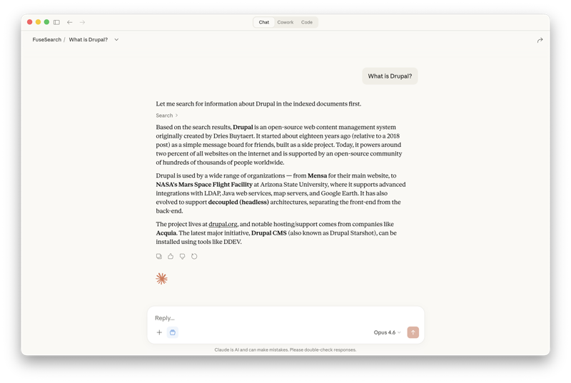
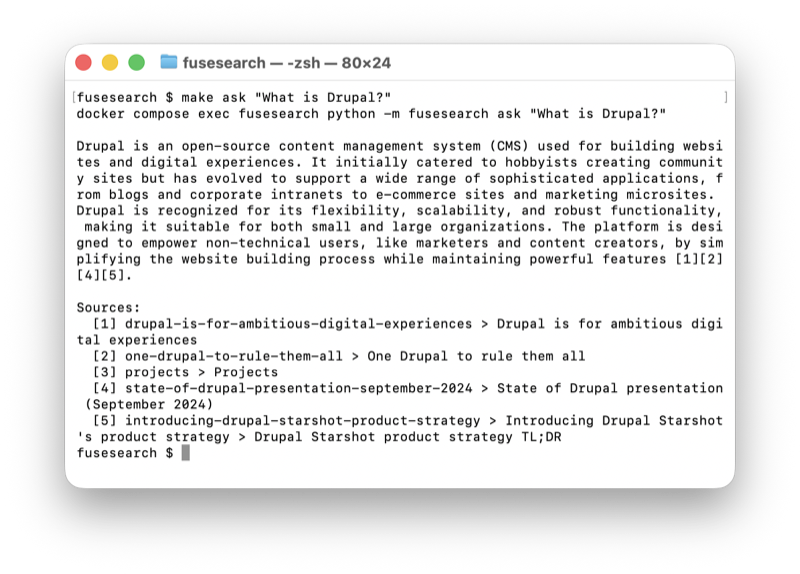

# FuseSearch

[](https://pypi.org/project/fusesearch/)

Multi-source search aggregation tool that unifies retrieval across diverse data sources — Confluence, MCP servers, local files, and more — using AI-powered search and response synthesis through a single query interface.



## Installation

```bash
pip install fusesearch
```

With all optional dependencies (MCP server, local embeddings, OpenAI):

```bash
pip install fusesearch[all]
```

## Quick Start

```bash
make build
make start
make index    # index docs from data/docs
make search "your query"
```

### Docker build options

The image installs the CPU-only build of PyTorch by default, a few hundred MB instead of several GB of CUDA libraries. Set these in `.env`, then run `make build`:

| Variable | Default | Use |
|---|---|---|
| `TORCH_INDEX_URL` | `https://download.pytorch.org/whl/cpu` | A CUDA index from [pytorch.org](https://pytorch.org/get-started/locally/) for NVIDIA GPU hosts (the container also needs GPU access in `docker-compose.override.yml`). Empty value: skip the pre-install. |
| `INSTALL_EXTRAS` | `all` | Package extras to install. For a slim image without torch (OpenAI or Ollama embeddings), use `mcp,openai,anthropic,ollama,confluence` with `TORCH_INDEX_URL=`. |

## Configuration File

An optional `fusesearch.yaml` defines named sources and default settings:

```bash
make config                          # creates data/fusesearch.yaml from fusesearch.example.yaml
make index-all                       # index every source in it
make index-source source=blog-posts  # index one source
```

```yaml
settings:
  search:
    rerank: true
sources:
  blog-posts:
    type: local_files
    paths: [/app/data/docs]
  eng-wiki:
    type: confluence
    url: https://myorg.atlassian.net/wiki
    username: user@example.com
    api_token: ${CONFLUENCE_API_TOKEN}
    spaces: [DEV, ENG]
```

See [`fusesearch.example.yaml`](fusesearch.example.yaml) for every setting.

- **Location:** `--config PATH`, else `FUSESEARCH_CONFIG`, else `fusesearch.yaml`/`.yml` in the working directory, else `data/fusesearch.yaml`/`.yml`. The Docker services see `./data/fusesearch.yaml`. Both locations are gitignored.
- **Precedence:** CLI flags > environment variables > config file > built-in defaults. For example, `search.hybrid: false` in the file, and `--hybrid` for a single search.
- **Secrets:** `${VAR}` is replaced with the environment variable. If it isn't set, a value under `settings:` stops every command with an error, while a value in a source only fails that source when it's indexed. Search and the other sources keep working.
- **Validation:** unknown keys are errors, so typos don't go unnoticed. `local_files` needs at least one path.

### Indexing

| Command | Indexes |
|---|---|
| `fusesearch index --all` | Every source in the config file. A failing source is skipped and the command exits with 1. |
| `fusesearch index --source NAME` | One source from the config file |
| `fusesearch index PATH...` | Local files, without a config file |
| `fusesearch index --source confluence` | Confluence, from the `CONFLUENCE_*` environment variables |
| `... --since 2026-01-01T00:00:00` | Only documents changed since then; nothing is deleted |

Plain `fusesearch index` lists the config sources instead of guessing.

Each source is synced on its own: re-indexing one source never deletes another source's chunks, and a sync that fetches 0 documents keeps the existing ones. Over REST: `POST /index` with `{"source": "blog-posts"}`.

The REST API has no authentication, and `POST /index` also accepts an ad-hoc `source_config` (any path in the container, or Confluence with the server's credentials). Keep port 8000 private, for example with `BIND_ADDRESS=127.0.0.1` in `.env`.

### Upgrading from 0.2.3 or earlier

Chunk IDs now include the source name, and the bundled Qdrant server moves from 1.16 to 1.20. The index has to be rebuilt once. Nothing is lost by that, because every source keeps its own data.

With the Docker setup, delete the Qdrant storage itself, not just the collection. Qdrant can't skip minor versions on existing storage, and an empty store needs no migration:

```bash
make stop
rm -rf data/qdrant
make build
make start
make index-all
```

Using FuseSearch as a library with your own Qdrant: drop the collection (`fusesearch`, `fusesearch-openai` or `fusesearch-ollama`) and re-index. Chunks left from 0.2.3 or earlier are never updated or deleted, and `fusesearch index` warns about them.

The MCP server now requires the MCP Python SDK 2.x, which the `[mcp]` extra installs.

### Qdrant version

The Docker setup pins the Qdrant server (`docker/qdrant.Dockerfile`, currently 1.20). A FuseSearch release raises it by at most one minor version, so updating release by release lets Qdrant migrate its storage on its own. If you skip releases, either update through them in order or delete `data/qdrant` and re-index. With your own Qdrant server, use 1.19–1.21: the client allows one minor version of difference.

## How It Works

```
Query → Embed → Vector Search  ─┐
                                ├→ RRF Fusion → Rerank (optional) → Results
                Keyword Search ─┘
```

## Embedding Providers

FuseSearch supports three embedding providers. Each uses a separate Qdrant collection due to different vector dimensions.

| | Local (default) | OpenAI | Ollama |
|---|---|---|---|
| **Model** | all-MiniLM-L6-v2 (384 dims) | text-embedding-3-small (1536 dims) | nomic-embed-text (768 dims) |
| **Quality** | Good for general English | Better for nuanced/complex queries | Good, varies by model |
| **Cost** | Free | ~$0.02 per 1M tokens | Free |
| **Privacy** | Data stays local | Data sent to OpenAI | Data stays local |
| **Offline** | Yes | No | Yes |

### Local (default)

Uses [sentence-transformers](https://www.sbert.net/). Runs entirely on your machine, no API key needed.

### OpenAI

Uses [OpenAI](https://platform.openai.com/)'s API. Higher quality embeddings but requires an API key.

To use OpenAI embeddings, add to your `.env`:

```env
FUSESEARCH_EMBEDDER=openai
OPENAI_API_KEY=sk-...
```

Or pass via CLI:

```bash
fusesearch --embedder openai index data/docs
fusesearch --embedder openai search "your query"
```

**Rate limits:** OpenAI Tier 1 accounts have a 40k tokens-per-minute limit on embeddings. FuseSearch retries automatically on rate limit errors, but initial indexing of large document sets will be slow. Higher tiers (auto-upgrade as you spend) increase this significantly. See [OpenAI rate limits](https://platform.openai.com/docs/guides/rate-limits).

### Ollama

Uses [Ollama](https://ollama.com/) to run embedding models locally. No API key needed.

1. Install from [ollama.com](https://ollama.com/)
2. Pull an embedding model: `ollama pull nomic-embed-text`

```env
FUSESEARCH_EMBEDDER=ollama
```

Or pass via CLI:

```bash
fusesearch --embedder ollama index data/docs
fusesearch --embedder ollama search "your query"
```

**Docker:** When running FuseSearch in Docker with Ollama on the host, set `OLLAMA_HOST` so the container can reach it:

```env
OLLAMA_HOST=http://host.docker.internal:11434
```

Other Ollama embedding models: `bge-m3`, `mxbai-embed-large`, `snowflake-arctic-embed`. Configure with:

```env
OLLAMA_EMBED_MODEL=bge-m3
```

## Reranking

Reranking uses a [cross-encoder](https://www.sbert.net/docs/cross_encoder/pretrained_models.html) model to rescore search results after retrieval. The cross-encoder evaluates each (query, document) pair directly, producing more accurate relevance scores than initial retrieval alone.

When enabled, FuseSearch overfetches 3x candidates from hybrid search, then reranks down to the requested limit.

### Usage

Per-request via CLI flag or API parameter:

```bash
fusesearch search "your query" --rerank
```

```bash
curl -X POST http://localhost:8000/search \
  -H "Content-Type: application/json" \
  -d '{"query": "your query", "rerank": true}'
```

Or enable it globally with an environment variable, or with `search.rerank: true` in the [config file](#configuration-file). `--no-rerank` turns it off for a single search:

```env
FUSESEARCH_RERANK=true
```

### Configuration

| Variable | Default | Description |
|---|---|---|
| `FUSESEARCH_RERANK` | `false` | Enable reranking globally |
| `FUSESEARCH_RERANKER` | `local` | Reranker provider |
| `FUSESEARCH_RERANK_MODEL` | `cross-encoder/ms-marco-MiniLM-L-6-v2` | Cross-encoder model |

The reranker is independent of the embedding provider — it works on raw text, not vectors. You can use `FUSESEARCH_EMBEDDER=openai` with `FUSESEARCH_RERANK=true`. The local reranker requires the `[local]` extra (`sentence-transformers`).

## Ask (LLM Synthesis)

The `ask` command searches your indexed documents and uses an LLM to synthesize an answer with citations. This is optional — search works without any LLM provider installed.



### Usage

```bash
fusesearch ask "What is Drupal?"
```

```bash
curl -X POST http://localhost:8000/ask \
  -H "Content-Type: application/json" \
  -d '{"query": "What is Drupal?"}'
```

### LLM Providers

| Provider | Model | Extra | Cost |
|---|---|---|---|
| Anthropic | claude-sonnet-4-20250514 | `[anthropic]` | Pay-as-you-go API |
| OpenAI | gpt-4o-mini | `[openai]` | Pay-as-you-go API |
| Ollama | llama3.2 | `[ollama]` | Free (runs locally) |

### Anthropic

Requires a separate API key (a Claude Pro/Team subscription does **not** include API access).

1. Create an account at [console.anthropic.com](https://console.anthropic.com/)
2. Add billing under **Settings > Billing** (pay-as-you-go)
3. Create a key under **Settings > API Keys**

```env
FUSESEARCH_LLM=anthropic
ANTHROPIC_API_KEY=sk-ant-...
```

### OpenAI

If you already have an API key for OpenAI embeddings, the same key works here.

1. Go to [platform.openai.com/api-keys](https://platform.openai.com/api-keys)
2. Create a new secret key

```env
FUSESEARCH_LLM=openai
OPENAI_API_KEY=sk-...
```

### Ollama

No API key needed. Runs entirely on your machine.

1. Install from [ollama.com](https://ollama.com/)
2. Pull a model: `ollama pull llama3.2`

```env
FUSESEARCH_LLM=ollama
```

If `FUSESEARCH_LLM` is not set, FuseSearch auto-detects the first installed provider. If none are installed, `ask` returns a clear error — search continues to work normally.

## MCP Server

The `fusesearch-mcp` Docker service exposes a streamable HTTP endpoint on port 8001. Tools: `search` (hybrid search), `count` (indexed chunks).

### Claude Code

```bash
claude mcp add fusesearch http://localhost:8001/mcp --transport http
```

### Claude Desktop

**Option 1: Connectors UI (recommended)**

In Claude Desktop, go to **Settings > Connectors > Add custom connector** and enter `https://localhost:8001/mcp`.

**Option 2: Config file with `mcp-remote` bridge (local dev)**

Add to `~/Library/Application Support/Claude/claude_desktop_config.json`:

```json
{
  "mcpServers": {
    "fusesearch": {
      "command": "npx",
      "args": ["-y", "mcp-remote", "http://localhost:8001/mcp", "--allow-http"]
    }
  }
}
```

Requires Node.js >= 18. `--allow-http` is required for plain HTTP (not needed for HTTPS).

## Releasing

FuseSearch can be published to PyPI in two ways. Use exactly one per version: PyPI never accepts the same version twice.

1. Bump `version` in `pyproject.toml`, commit and push.
2. Publish, either:
   - **Via GitHub:** create a GitHub release `vX.Y.Z` (`make release`). The [publish workflow](.github/workflows/publish.yml) builds the package and uploads it to PyPI with trusted publishing; no token needed.
   - **Manually, without GitHub:** set `PYPI_TOKEN` in `.env` and run `make publish`. It builds the package in Docker and uploads it with twine.
3. Check the result: `pip install fusesearch==X.Y.Z`. PyPI can take a few minutes to list a new version.

`make package` builds the wheel and sdist into `dist/` without uploading.
